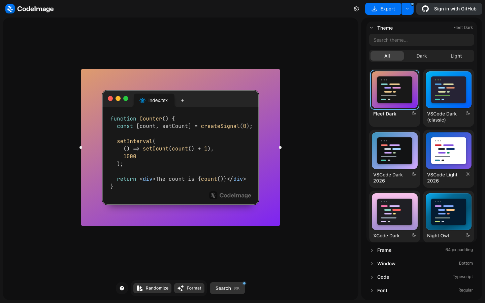
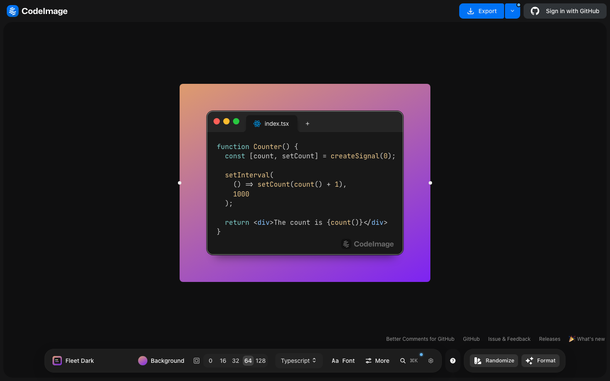
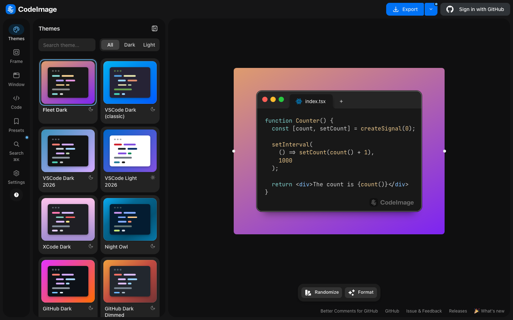

# CodeImage design decisions

This page records the design decisions behind the CodeImage editor, with the reason for each. Read it before you add a control, a panel, a setting or an animation. It covers the unified editor in `apps/codeimage/src/pages/UnifiedEditor/`. The folder's own `README.md` explains how the code is built.

A rule here is a decision the maintainer made while reviewing a working build. Change one only with a build that shows the alternative.

## Principles

1. **The image is the product.** The frame stays in view and stays still. Nothing that opens may move it, resize it or change its zoom.
2. **Islands, not borders.** Controls sit in rounded islands on the app background. Space separates groups. Hairline dividers and bordered tiles do not.
3. **Relaxed density.** A control needs room to be read and hit. Showing more options at once is not a goal.
4. **Overlays over layout shifts.** A picker opens over the panel that holds it. A panel does not grow, and the canvas does not resize.
5. **The real components.** Use `@codeui/kit`, `@codeimage/ui` and the production pickers. Do not hand-build a control that the kit has.
6. **One place for each thing.** One settings dialog, one Export control, one command menu, one header. Each layout places them. None owns a copy.
7. **Preview, then commit.** Hovering or walking a list shows the value on the canvas. Only a click or Enter saves it.

## Layouts

The editor has two layouts. A layout decides where the canvas, the controls and the theme picker sit. It does not render the header, the settings or the command menu.

| Layout  | Status     | Shape                                                                                |
| ------- | ---------- | ------------------------------------------------------------------------------------ |
| Sidebar | Default    | The sections beside the canvas, on the right or the left, as an Accordion or a Rail. |
| Dock    | Experiment | A floating bar over the canvas. It takes no layout space.                            |

The Sidebar's navigation is a preference in Settings, Appearance. The Accordion is one panel with one section open at a time; it is the default. The Rail is a column of icons with one panel per section; it was the Studio layout. Inspector and Studio became one layout because both showed one section at a time, and their contents had drifted apart: different groups, control order, font picker, and presets only in Studio. Both navigations now render the same sections from `variants/sidebar/panels.tsx`, so a change to a section reaches both.

- A read-only snippet is a page mode. A layout draws no container for controls it does not show, so the canvas takes the space. Controls that open during editing must leave the frame still.
- The Sidebar is the default because it is the closest to what users know, and every option is one click away.
- In the Accordion, one section is open at a time. Several open sections made the panel scroll further with each click.
- Dock floats over the canvas. Its menus open as overlays above it. An earlier build gave the dock its own row, and the canvas shrank each time a menu opened.
- A layout that is not the default lives under Settings, Experiments. It moves out of Experiments only by replacing the default.

## Spacing and size

| Thing                          | Value                            |
| ------------------------------ | -------------------------------- |
| Page inset, top and sides      | 8px                              |
| Gap between header and islands | 8px                              |
| Header row height              | 36px, 40px at 768px and narrower |
| Control row height             | 36 to 40px                       |
| Island padding                 | 12 to 16px                       |
| Logo height                    | 28px                             |
| Phone breakpoint               | 768px and narrower               |

- The header has no bar of its own. It is as tall as its controls and reads as the first row of islands. Its edges meet the edges of the islands under it.
- A layout keeps its first islands 8px from the sides and adds no space at its top.
- Rows of 28px and a 300px panel were tried first and rejected as too compact.
- Text fields on a phone use 16px text, so that iOS does not zoom the page on focus.

## Header

The header starts with the logo, dashboard link and snippet name where they apply.
Its right-aligned actions are What's new, Commands, Experiments, Settings, Share, Export, and the sign-in button or user badge.
Commands, Experiments and Settings move into the layout as described below.

- The settings gear appears in the header only when the layout has no entry of its own. Studio opens the settings from the foot of its rail. Dock opens them from its bar. On a phone the gear is always in the header.
- Studio keeps Commands, Settings, Experiments, and a GitHub icon link together at the bottom of its desktop rail. The shell tracks Commands, Settings and Experiments ownership. Inspector keeps all three in the header; Dock keeps Experiments there.
- What's new is the first action, so its handover with the Nudge leaves the other buttons in place. What's new and Experiments hide at 768px and below.
- There is no menu behind the logo. Its entries moved to the settings and the command menu.

## Theme picker

A theme is drawn as a small window in the theme's own colours, with its full name. This is the Window card and it is the default. Orb and Aa list are Experiments.

- A miniature of real code was rejected. At card size it does not tell one theme from another.
- A palette strip was tried and removed. It showed colours with no sense of how the theme looks.
- The card colours come from the theme itself. `syntax.ts` reads them from the theme's CodeMirror extensions, so a card cannot drift from the editor.
- The grid always shows at least two cards per row in a panel, and at least twelve themes at 1440x900.
- Hover or keyboard focus previews the theme on the canvas. Leaving the list or pressing Escape puts the applied theme back.
- Scrollbars inside pickers and menus set `scrollbar-color`, so that a system with visible scrollbars does not show a white track on a dark panel.

## Pickers and overlays

- The colour, aspect ratio, font and window style pickers open as overlays anchored to their row. They do not expand inline.
- An overlay has no backdrop and does not dim the page. The frame behind it stays readable.
- The command menu floats at the bottom centre, six rows tall, with no scrim, so the frame stays in view while a list is walked.
- A modal dialog is for the settings and for a decision that blocks, such as the secrets review before an export.

## Keyboard shortcuts

- Desktop help has a labelled **Shortcuts** button with a `?` keycap at the top left of the shared canvas.
- The trigger sits outside the exported frame. It never reserves canvas space or changes frame zoom.
- If the trigger would touch the frame or exceed the canvas, hide it. The `?` key and command-menu entry remain available.
- One shared help component renders the shortcut definitions. Desktop help opens below its trigger, without a backdrop or an opening animation.
- Phone help keeps its existing trigger and dialog while the mobile redesign proceeds separately.

## Settings

One dialog in two panes, with sections on the left and rows on the right. The sections are General, Appearance, Export, Experiments, What's new and About.

- A row is a title, one line that explains it, and its control on the right.
- A choice uses a segmented control or a switch. A choice out of several with a preview uses cards.
- Do not use the kit `Select` inside the dialog. The dialog is modal, and the list that the select adds outside it is hidden from assistive technology.
- Export settings live here, not in a popover beside the Export button.
- Experiments holds every option that is not the default yet, with a `Default` tag on the current default and one `Restore defaults` action.
- About holds GitHub, Bugs and feedback, Releases, and Better Comments for GitHub. External-link commands use the same destinations. Better Comments retains its analytics event.
- Dock and Studio have no footer. What's new remains in the shared header and Settings archive.
- Under 769px the left pane becomes two rows on top: the search, then the sections as tabs.

## Export

- Settings, Appearance offers Menu and Dialog export styles. Menu is the default.
- In Menu style, the main Export button downloads with the saved settings. Its arrow opens a panel for one export's format, scale and JPEG quality.
- In Dialog style, Export opens a dialog with a preview and the same one-off choices. Both styles can save the choice as the default.
- Both surfaces use the same action registry for one image per tab, Copy, Open in a new tab, Redact secrets, and Export settings.
- Ctrl+S exports with the saved settings in either style.
- Every desktop canvas toolbar contains Format code and Copy image. Copy image always copies a PNG at the chosen scale.
- Shortcut help uses the labelled button at the top left of the canvas in all three layouts. The toolbar has no `?` entry.
- Randomize stays in the command menu and its shortcut, without a button.
- An export that would show a secret asks first. Every export action shares that review, which retains the one-off choice.

## Command menu

Cmd+K, or Ctrl+K off Apple platforms, opens it in every layout.
Inspector has a labelled Commands button in the header. Studio has one at the bottom of its rail. Dock keeps its icon trigger.
The command menu lists every theme, every option of every visible control, the actions, the exports and the settings.

- A new control or setting must appear in it. The menu reads the same model and the same settings rows, so this is automatic for anything added as data.
- The highlighted row previews on the canvas. Enter saves it. Escape ends the preview.
- It does not open over an open menu, popover or dialog.

## Motion

Motion follows Emil Kowalski's rules for interface animation.

- Ease out. The standard curve is `cubic-bezier(0.23, 1, 0.32, 1)`.
- Keep it short. Most transitions take 120 to 260ms, and none of the editor's controls takes more than 300ms.
- Animate `transform`, `opacity` and `clip-path`. Do not animate layout.
- Every animation can be interrupted, and scales from the element that opened it.
- An action from the keyboard does not animate.
- Under `prefers-reduced-motion`, only opacity changes.
- Something seen many times a day stays still. A dot that stays on screen for days does not pulse.

The What's new surfaces keep their own table of durations in `components/WhatsNew/motion.ts`.

## Styling

- Styles are vanilla-extract `.css.ts` files with tokens from `@codeimage/ui` (`themeVars`). Plain CSS files are not accepted, even for an experiment.
- Read state from data attributes on the page root, such as `data-layout`, `data-panel-nav` and `data-panel-side`, not from generated class names.
- Use `zoom` to fit the frame, not `transform`. A transformed ancestor misplaces CodeMirror's tooltips.

## The code editor

The editor is CodeMirror 6. CodeMirror owns the DOM it renders and redraws it at any time, so a change made to it by hand is lost or fights with CodeMirror.

- Change what the editor shows through CodeMirror, not through the DOM: `Decoration.line` or `Decoration.mark` for classes and attributes on lines and text, `GutterMarker` for gutter content, `showTooltip` or `hoverTooltip` for anything that floats over the code.
- React to the editor through CodeMirror: `EditorView.domEventHandlers` for events, `EditorView.updateListener` or a `ViewPlugin` for selection and document changes. Do not listen on `document` for the editor's selection, and do not add listeners to `view.dom` or `view.contentDOM` by hand.
- Do not query or edit the editor's DOM (`.cm-line`, `view.dom`, `view.contentDOM`). For positions, use `view.coordsAtPos`, `view.lineBlockAt` and `view.posAtCoords`.
- To hide something, remove its extension (a `Compartment`, or `createExtension` returning `[]`). Do not clean the DOM afterwards.
- Something drawn only while editing must not change the layout. The frame fits the longest line, so a line class may change opacity, background or an inset `box-shadow`, but an inline widget that adds width moves the frame.
- Markup that no live `EditorView` owns, such as `StaticCodeView`, the animation scenes and export clones, may be read from the DOM.
- Tooltips of the canvas editor mount in the stage's popup host, right after the frame. It sits outside FitFrame's zoom and outside the export copy, so markers, menus and toolbars keep their size and never reach an image. They stay inside the canvas, under panels and sheets. Tab reaches them right after the editor, and a focus entry just before the editor sends Shift+Tab to the line marker, as when the markers sat in the gutter.

## Text and languages

- Every label, hint, tooltip and accessible name goes through the locale files. The app ships English, Italian, German and Spanish, and a missing key fails the typecheck.
- A label is a noun or a short verb phrase. A hint is one line.

## Accessibility

- Every control works from the keyboard, and a list previews on focus as it does on hover.
- Closing a dialog or a menu returns focus to what opened it.
- Opening a dialog on a phone does not focus a text field, so the keyboard does not cover it.
- Page zoom is off on purpose. `index.html` sets `maximum-scale=1.0, user-scalable=no`. This is the maintainer's decision, not a leftover. The frame fits itself to the screen.

## Screenshots

`docs/design/screenshots/` holds six reference views: the three layouts, the settings, the command menu and the default layout on a phone. Refresh them in the pull request that changes the look, with a dev server running:

```sh
node .agents/skills/verify-codeimage/scripts/capture-design.mjs http://localhost:4343
```

| Sidebar Accordion, the default                                     | Dock                                              | Sidebar Rail                                                 |
| ----------------------------------------------------------- | ------------------------------------------------- | ------------------------------------------------------------ |
|  |  |  |

The audit that started this work is in [`docs/design/ui-audit.md`](docs/design/ui-audit.md).

## How a decision gets in here

1. Build the alternative behind an Experiment, with its own card in Settings.
2. Check it at 1440x900, 1024x768 and 390x844, in a browser with visible scrollbars as well as overlay ones.
3. When the maintainer picks it, make it the default, remove the loser, and update this page in the same pull request.
