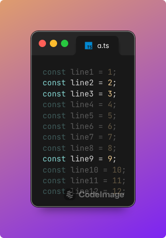
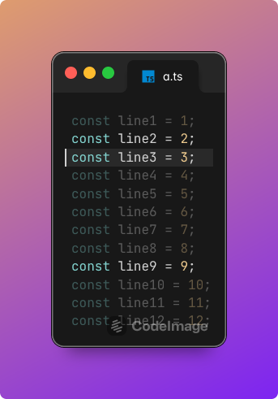
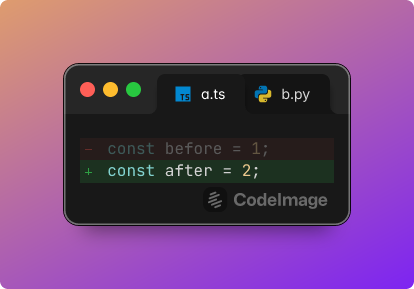
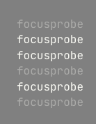

# CLI feature flag evidence

The CLI uses P5's diff and annotation parsers, P6's detector and redactor,
P7's target definitions and signature view, and P9's alt-text function.
P8's CLI behavior needs no P8 web code.

## Reproduce

All commands run with Node. No development server or browser is needed.

```sh
pnpm install
pnpm --filter=@codeimage/api exec prisma generate
pnpm --filter=@codeimage/prisma-models build
pnpm --filter=@codeimage/api build:ts
pnpm libs:build
pnpm --filter=@codeimage/cli test
pnpm --filter=@codeimage/render test
pnpm --filter=@codeimage/app test src/core/diff/parseAnnotations.test.ts src/core/diff/parseUnifiedDiff.test.ts src/core/altText.test.ts
pnpm lint
pnpm typecheck
```

Run the live verifier in a tmux pane after the build.

```sh
node packages/cli/scripts/verify-feature-flags.mjs /tmp/swarm-cli-flags
```

The script invokes the built CLI, creates its own synthetic inputs, asserts
output contents, and writes `feature-flags-results.json`. It saves stdout
and stderr for every run. The original run also has `tmux-pane.txt` and the
build and check logs in `/tmp/swarm-cli-flags/`.

## Focus redesign verification, 2026-11-14

Merged P5 head `576b9ea0` into PR #704 head `ffc0827c` with merge commit
`06ec9fc6`. Both heads remain ancestors. The target branch was occupied by
another worktree, so this checkout uses `feat/cli-focus-ranges` and pushes
`HEAD:feat/cli-feature-flags` without a force push.

The merge keeps the CLI parser's `sourceLines` mapping and adopts P5's
`focusedLines`. `--focus 2-3 --focus 9` adds both ranges without adding
highlights. Focus can share a line with highlight, added, or removed marks.
Shiki focus annotations add to the same set. `--lines` clips and remaps the
set. No focused line in the output means no dimming. The renderer validates
snapshots and defaults a missing `focusedLines` to an empty list. The CLI
pipeline uses the normalized snapshot type.

- `pnpm install` and `pnpm libs:build` pass. Install reports peer, deprecation,
  and optional build-script warnings, plus a solid-dnd patch warning.
- CLI tests pass, 77 tests across six files.
- Renderer tests pass, 48 tests, including focus pixels.
- Shared diff, annotation, and alt-text tests pass, 32 tests.
- `pnpm lint` and full workspace `pnpm typecheck` pass. App lint has 32 existing warnings.
- All 28 built CLI invocations pass in tmux. Two assert exit 2 for invalid
  options. Focus without highlight succeeds. Bare `--focus` needs a range.
- The six-line PNG probe focuses lines 2, 3, and 5. Those rows are pixel-identical
  to the unmarked baseline. Lines 1, 4, and 6 retain 0.34949 of their original
  RGB contrast against gray. `focus-pixels.json` records each row.
- Focus outside the document produces exactly the unmarked PNG. Focus plus
  highlight and focus plus diff produce distinct images with both marks visible.
- A packed tarball installs outside the workspace and renders a 1200 by 630
  PNG with repeated focus ranges, a highlight, redaction, a signature, and a
  masked alt sidecar. The shared migration parser is bundled with the renderer.

Logs, stdout, stderr, receipts, the packed CLI, and `tmux-pane.txt` are in
`/tmp/cli-704-focus-ranges/` on the verification machine. The checked-in PNGs
below were opened and inspected. The final verifier run exits with 0.
The pixel probes use a square gray frame and Dracula theme to isolate text
from rounded corners and Fleet Dark's separate code background. Initial
probe assertions failed on those decorations before the fixtures were corrected.

Reproduce this run in tmux after the build with:

```sh
tmux new-session -s cli704-focus
node packages/cli/scripts/verify-feature-flags.mjs /tmp/cli-704-focus-ranges
```

## Plan coverage

| Plan lane         | CLI evidence                                                                                                                                                                                                                                                                                                                                                      |
| ----------------- | ----------------------------------------------------------------------------------------------------------------------------------------------------------------------------------------------------------------------------------------------------------------------------------------------------------------------------------------------------------------- |
| P5 lane 9         | A two-file diff through stdin and a `.diff` file becomes tabs with inferred languages and added/removed marks. Repeatable focus ranges stay sharp independently of highlight and diff marks. Bare `--focus` exits with 2. Focus-only, overlapping highlight, diff, and out-of-range PNGs pass. Annotation comments disappear from the alt sidecar.                |
| P6 lanes 7 and 8  | Three synthetic secrets produce three location/rule diagnostics and one summary. PNG and SVG render successfully. The redacted SVG is byte-identical to an unredacted render of the masked code from the alt sidecar, and that sidecar contains no token. `--no-redact` emits no diagnostics, preserves the original alt text, and produces different PNG pixels. |
| P7 lane 7         | All four target PNGs have their exact dimensions. `--scale` with `--size` exits with 2, and the renderer still exports a target at its exact size when a snapshot asks for scale 2. Signatures render in both corners. A 60-line snippet fits inside the target. Open Graph also renders as JPEG.                                                                 |
| P8 lane 7         | Three input files produce `out-01.png` through `out-03.png`. Each sidecar contains its own tab's code. Every PNG remains 1600 by 900 when combined with `--size`. Split SVG also produces numbered files.                                                                                                                                                         |
| P9 lanes 6 and 10 | The image gets a `.png.alt.txt` sidecar. Its header names the language, tab, and line range. `--lines 5-12` reports lines 5 to 12. Long Unicode input ends with the shared truncation note within 1,000 graphemes.                                                                                                                                                |

The CLI tests also inspect the static markup for marks, focus, and
signature positions. The CLI tests compare sidecars with the shared
`altText` function. The verifier's synthetic credentials are test fixtures.

## Independent review

The rebase replays the four dependency merges onto the new P4 head. Each
conflict takes the original merge's resolution, because the restack touched
none of those files. The replayed alt-text merge differs from the original
one by exactly the P4 restack diff, with the same `git patch-id`. The renderer
commit's conflict with P4's device-pixel sizing resolves so that a named
target measures and renders at pixel ratio 1.

Review changes, each verified against the rebased head:

- The Node target layout copied FittedWindow's 480 px minimum width and
  FrameSignature's 66 px signature space. It now lives in the render entry
  and imports both. A named target's scale of 1 is set once where the
  snapshot is parsed. All 34 verifier artifacts are byte-identical before
  and after this change.
- `bin.ts` and the flag tests now share one pipeline, so the tests exercise
  the shipped flag order.
- `--size` with `--scale`, `--signature-position` without a signature, and
  the old boolean `--focus` with no highlighted line were silently ignored or
  dimmed every line. That review added usage errors. The focus redesign above
  replaces the boolean validation with required range parsing. The help aligns with the
  P4 options, and one match prints `redacted 1 secret`.
- The verifier's SVG token search could never fail, because Takumi draws
  glyphs as paths. It is replaced by the masked-render equality above.

Redaction was also probed by hand on stdin, two files, `--split-tabs` with
`--alt`, `--diff` input, an annotated line, and PNG to stdout. Every run
printed a location and rule per match, and no output or sidecar held a token.

One P4 behavior is out of scope here. `buildSnapshot` keeps a file's final
newline as an empty last line, so a two-line file renders three lines and its
alt text says `lines 1 to 3`.

## Reviewed images

The added and removed lines have visible signs and colored backgrounds.
Focus dims the other lines and preserves the focused lines independently of color marks.










The named target centers the window, preserves the web target's minimum
window width, and keeps the signature in the selected corner.


## Limits

The task requires Node-only verification. Web comparison lanes, browser
recordings, and feature performance benchmarks were not run for this CLI
integration. The upstream feature PRs own their web verification. The
earlier independent Opus review is recorded above. This focus update has a
local diff review and the automated checks above; no fresh independent review
is claimed.

The root `libs:build` skips Prisma models until the client is generated.
The API's `build:types` script currently lacks `declaration` in its tsconfig.
The commands above use `build:ts` to produce the API schema declarations
needed by the app typecheck. No source workaround is needed.
