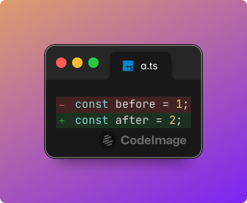
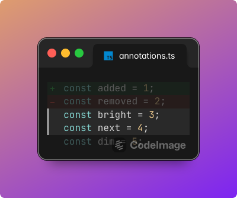
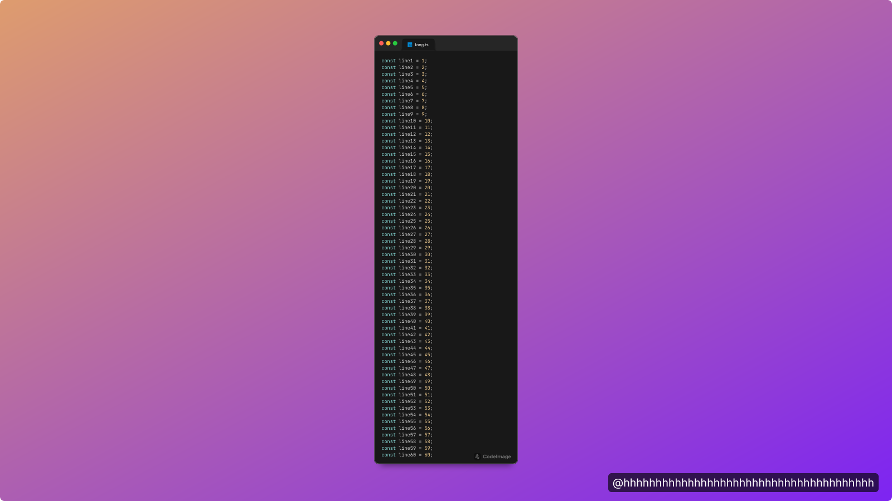

# CLI feature flag evidence

The CLI uses P5's diff and annotation parsers, P6's detector and redactor,
P7's target definitions and signature view, and P9's alt-text function.
P8's CLI behavior needs no P8 web code.

## Reproduce

All commands run with Node. No development server or browser is needed.

```sh
pnpm install
pnpm --filter=@codeimage/api exec prisma generate
pnpm --filter=@codeimage/prisma-models build
pnpm --filter=@codeimage/api build:ts
pnpm libs:build
pnpm --filter=@codeimage/cli test
pnpm --filter=@codeimage/render test
pnpm --filter=@codeimage/app test src/core/diff/parseAnnotations.test.ts src/core/diff/parseUnifiedDiff.test.ts src/core/altText.test.ts
pnpm lint
pnpm typecheck
```

Run the live verifier in a tmux pane after the build.

```sh
node packages/cli/scripts/verify-feature-flags.mjs /tmp/swarm-cli-flags
```

The script invokes the built CLI, creates its own synthetic inputs, asserts
output contents, and writes `feature-flags-results.json`. It saves stdout
and stderr for every run. The original run also has `tmux-pane.txt` and the
build and check logs in `/tmp/swarm-cli-flags/`.

## Results

- CLI tests pass, 68 tests across six files, including one test file per flag.
- Renderer tests pass, 34 tests.
- Shared diff, annotation, and alt-text tests pass, 31 tests.
- `pnpm libs:build`, `pnpm lint`, and `pnpm typecheck` pass. Lint retains the app's existing warnings.
- A packed tarball installs in an isolated directory and renders a redacted 1200 by 630 image with a signature and alt sidecar.
- Twenty CLI invocations pass and their output files satisfy the assertions below.

| Plan lane         | CLI evidence                                                                                                                                                                                                                                                                       |
| ----------------- | ---------------------------------------------------------------------------------------------------------------------------------------------------------------------------------------------------------------------------------------------------------------------------------- |
| P5 lane 9         | A two-file diff through stdin and a `.diff` file becomes tabs with inferred languages and added/removed marks. Highlight and focus change rendered pixels. Annotation comments disappear from the alt sidecar.                                                                     |
| P6 lanes 7 and 8  | Three synthetic secrets produce three location/rule diagnostics and one summary. PNG and SVG render successfully. Original tokens are absent from the SVG and alt sidecar. `--no-redact` emits no diagnostics, preserves the original alt text, and produces different PNG pixels. |
| P7 lane 7         | All four target PNGs have their exact dimensions, including with `--scale 2`. Signatures render in both corners. A 60-line snippet fits inside the target. Open Graph also renders as JPEG.                                                                                        |
| P8 lane 7         | Three input files produce `out-01.png` through `out-03.png`. Each sidecar contains its own tab's code. Every PNG remains 1600 by 900 when combined with `--size`. Split SVG also produces numbered files.                                                                          |
| P9 lanes 6 and 10 | The image gets a `.png.alt.txt` sidecar. Its header names the language, tab, and line range. `--lines 5-12` reports lines 5 to 12. Long Unicode input ends with the shared truncation note within 1,000 graphemes.                                                                 |

The CLI tests also inspect the static markup for marks, focus, and
signature positions. The CLI tests compare sidecars with the shared
`altText` function. The verifier's synthetic credentials are test fixtures.

## Reviewed images

The added and removed lines have visible signs and colored backgrounds.
Focus dims the other lines and preserves the highlighted lines.






The named target centers the window, preserves the web target's minimum
window width, and keeps the signature in the selected corner.




## Limits

The task requires Node-only verification. Web comparison lanes, browser
recordings, and feature performance benchmarks were not run for this CLI
integration. The upstream feature PRs own their web verification. No
cross-model review was delegated from this implementation sub-agent.

The root `libs:build` skips Prisma models until the client is generated.
The API's `build:types` script currently lacks `declaration` in its tsconfig.
The commands above use `build:ts` to produce the API schema declarations
needed by the app typecheck. No source workaround is needed.
